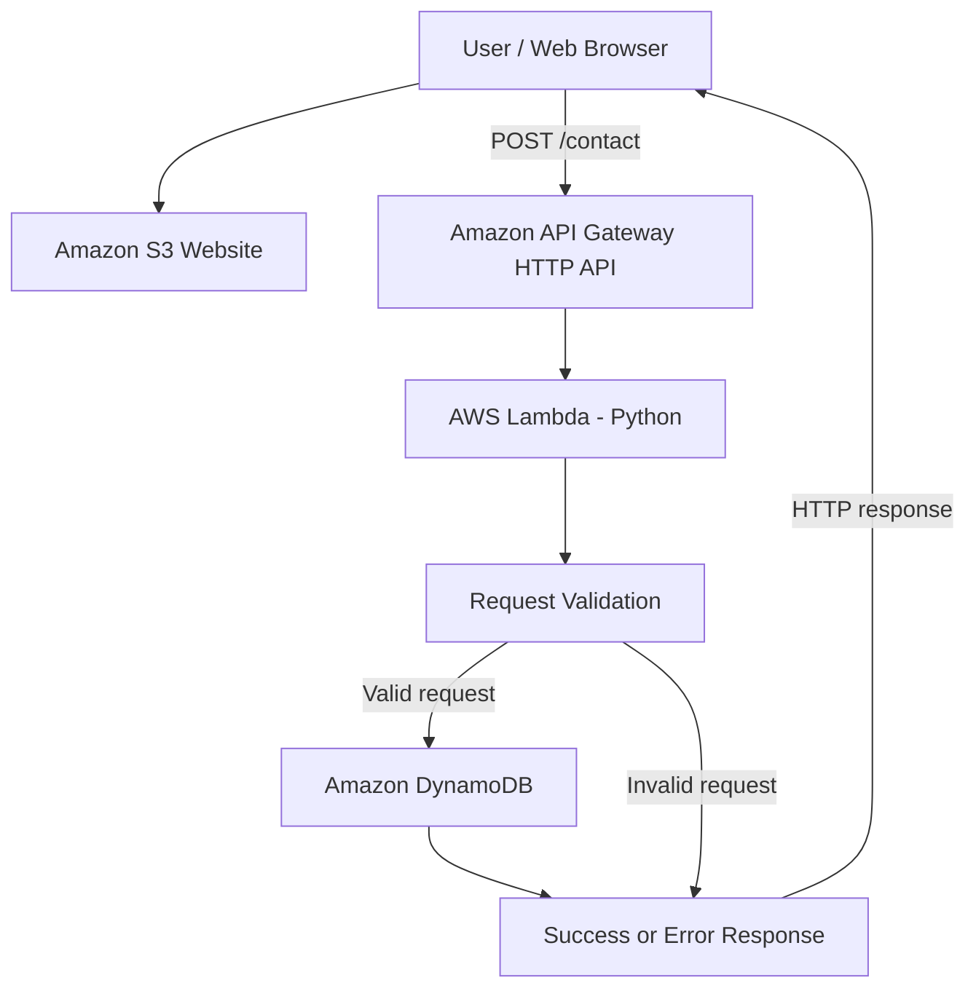

# Cloud Contact Form — AWS Serverless Web Application

A cloud-hosted contact form built using Amazon S3, Amazon API Gateway, AWS Lambda, Amazon DynamoDB, and AWS SAM. The application demonstrates how a static frontend can communicate with a serverless backend to validate and store contact form submissions.

## URL :   http://cloud-contact-form-frontendbucket-yjb5kcx40aly.s3-website-ap-southeast-2.amazonaws.com/
## Project Overview

The Cloud Contact Form is a beginner-level AWS Cloud Engineer internship project. It demonstrates static website hosting, API integration, serverless computing, database storage, input validation, and cloud deployment.

### Features

- Static website hosted on Amazon S3.
- Contact form with client-side and backend validation.
- API Gateway HTTP API for handling form submissions.
- AWS Lambda function written in Python.
- Amazon DynamoDB for storing submitted messages.
- Success and error feedback in the frontend.
- Cross-Origin Resource Sharing (CORS) configuration.
- Infrastructure deployment using AWS SAM and AWS CloudFormation.
- Resource configuration designed with low-traffic usage and cost awareness in mind.

## Technology Stack

| Technology | Purpose |
|---|---|
| HTML, CSS, JavaScript | Frontend interface |
| Amazon S3 | Static website hosting |
| Amazon API Gateway | HTTP API endpoint |
| AWS Lambda | Serverless request processing |
| Python | Backend logic and validation |
| Amazon DynamoDB | Contact message storage |
| AWS SAM | Infrastructure deployment |
| AWS CloudFormation | Infrastructure provisioning |

## Architecture

The application follows a serverless request-processing workflow.



### How It Works

1. The user opens the contact form hosted on Amazon S3.
2. The frontend validates the submitted fields.
3. JavaScript sends a JSON HTTP POST request to the API Gateway `/contact` endpoint.
4. API Gateway invokes the Lambda function.
5. Lambda validates the request and processes the submission.
6. Valid submissions are stored in DynamoDB.
7. The API returns a response, and the frontend displays a success or error message.

## AWS Resources

The deployed project uses the following resources:

- **Amazon S3:** Hosts the static website files.
- **Amazon API Gateway:** Exposes the `/contact` HTTP endpoint.
- **AWS Lambda:** Processes submissions using Python.
- **Amazon DynamoDB:** Stores contact messages.
- **Amazon CloudWatch Logs:** Supports backend and API troubleshooting.
- **AWS SAM / CloudFormation:** Defines and deploys the infrastructure.

## Project Structure

```text
cloud-contact-form/
├── frontend/
│   ├── index.html
│   ├── styles.css
│   ├── app.js
│   ├── config.js
│   └── config.example.js
├── src/
│   ├── handler.py
│   └── validation.py
├── template.yaml
├── samconfig.toml
├── README.md
└── tests/
```

The structure above is illustrative. Keep only files and folders that actually exist in your repository.

## Deployment Guide

### Prerequisites

- An AWS account.
- AWS CLI configured with appropriate credentials.
- AWS SAM CLI.
- Python compatible with the project's Lambda runtime.
- Access to the AWS region used for deployment.

### 1. Configure AWS

Configure the AWS CLI if it has not already been configured:

```bash
aws configure
```

Verify the active AWS identity:

```bash
aws sts get-caller-identity
```

Never commit AWS credentials, access keys, or secrets to GitHub.

### 2. Build the application

From the project root:

```bash
sam build
```

### 3. Deploy the infrastructure

For the Sydney region used by this deployment:

```bash
sam deploy --guided --region ap-southeast-2
```

Follow the prompts and supply the appropriate parameters. Set `AllowedOrigin` to the exact S3 website origin used by the frontend.

For subsequent deployments, use the saved SAM configuration where appropriate.

### 4. Configure the frontend

Ensure `frontend/config.js` contains the deployed API endpoint:

```javascript
window.APP_CONFIG = {
  apiUrl: "YOUR_API_ENDPOINT"
};
```

Replace the placeholder with the actual API endpoint from the CloudFormation stack outputs, including `/contact`.

Do not include credentials or secrets in frontend configuration.

### 5. Upload frontend files

After replacing the bucket placeholder with the deployed frontend bucket name:

```bash
aws s3 sync frontend/ s3://YOUR_FRONTEND_BUCKET --region ap-southeast-2
```

Ensure that the intended configuration file is uploaded and that obsolete files are removed or replaced when necessary.

### 6. Test the application

Open the website URL from the CloudFormation stack outputs. Submit a test message and confirm that it is saved in DynamoDB.

## Testing

The following checks should be completed and recorded before submission.

| Test | Expected result |
|---|---|
| Open the website | Contact form loads |
| Submit valid information | Success response |
| Submit empty required fields | Validation message |
| Submit an invalid email | Validation message |
| Submit a valid request | Record appears in DynamoDB |
| Test an API failure | Useful error message |
| Send a browser request | CORS permits the configured website origin |

## outputs 


## Security Considerations

- Lambda receives only the DynamoDB permissions needed for its intended write operation.
- DynamoDB encryption at rest is enabled.
- S3 public website access is intentional for this static website; the bucket policy should allow public reads only for website objects.
- The S3 website endpoint uses HTTP rather than HTTPS. HTTPS would require an appropriate hosting and distribution setup.
- Frontend validation improves usability, but backend validation remains essential.
- CORS restricts browser access by origin; it is not authentication or authorization.
- AWS credentials and secrets must not be committed to the repository.
- Review permissions and public exposure before using the application for real customer information.

## Cost Awareness

The infrastructure is configured with low-traffic assumptions, including:

- Lambda configured with 128 MB memory and a five-second timeout.
- DynamoDB on-demand billing.
- DynamoDB TTL configured for message expiration after 90 days.
- CloudWatch log retention configured for seven days.
- No NAT Gateway or VPC configured for this application.

These settings help limit unnecessary resource usage, but they do not guarantee zero cost. Charges can depend on usage, account eligibility, region, and AWS pricing. Monitor AWS billing and configure a budget alert where available.

## Future Improvements

- HTTPS using a suitable hosting and distribution configuration.
- CAPTCHA or other anti-spam protection.
- Rate limiting and additional abuse protection.
- Improved monitoring and alarms.
- Automated tests and CI/CD deployment.
- Authentication or stronger access controls if the application later handles sensitive information.

## Learning Outcomes

This project demonstrates practical understanding of static website hosting, HTTP APIs, serverless functions, database integration, CORS, infrastructure as code, deployment troubleshooting, and basic cloud cost and security considerations.

## License

Add an appropriate license if you intend to distribute or reuse this project publicly.
